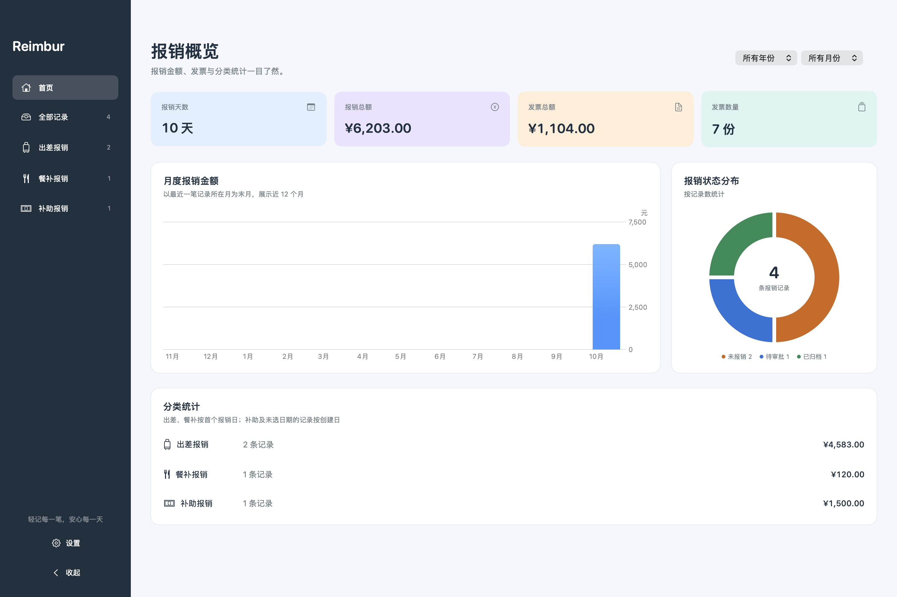
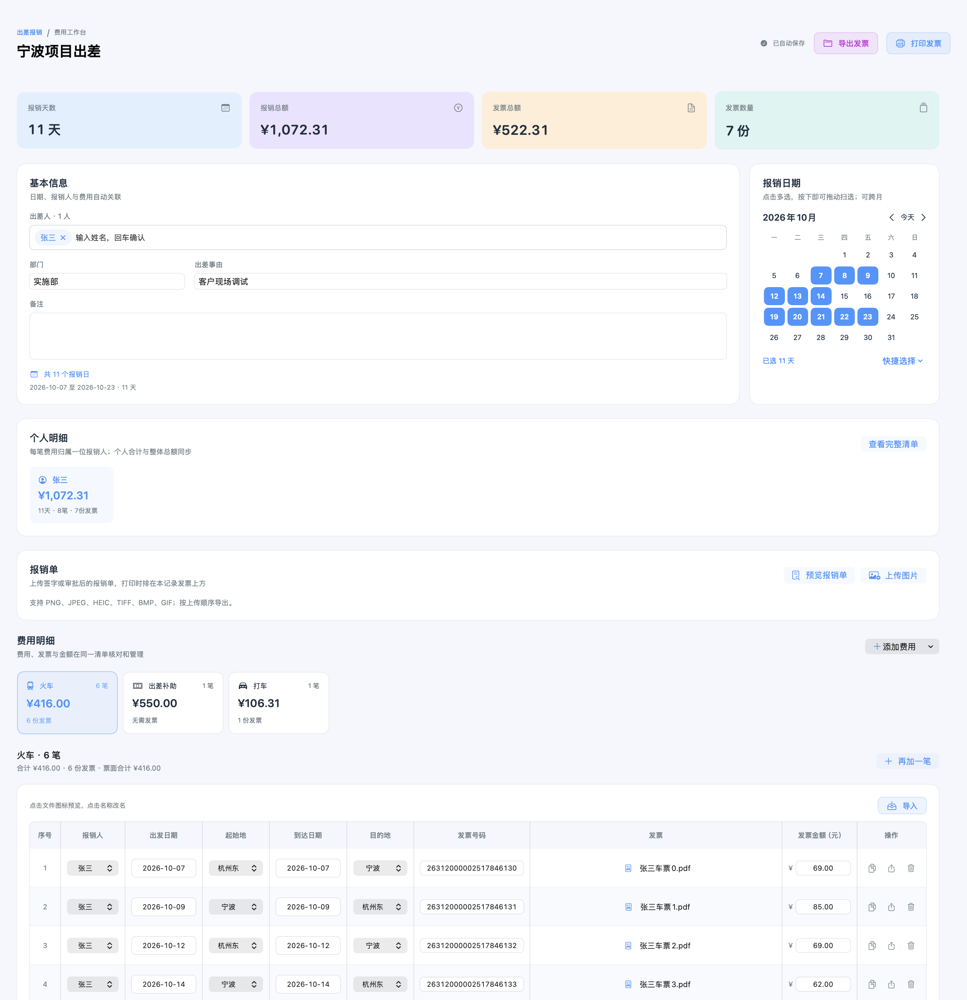
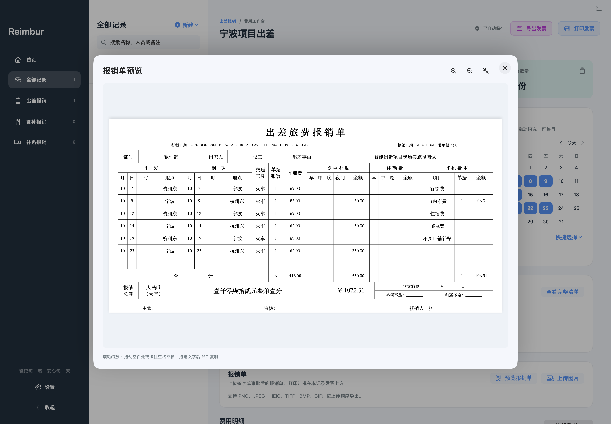
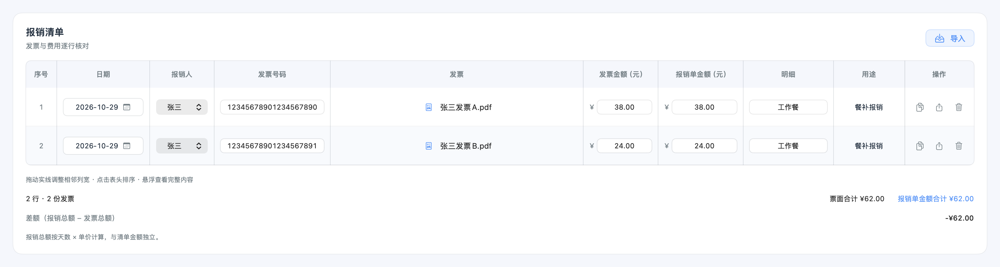

# Reimbur 轻记报销

一款原生 macOS 报销管理软件，支持出差、餐补和补贴报销。使用 SwiftUI、SQLite 和 PDFKit，记录与附件保存在本机，可离线使用。

[下载安装包](https://github.com/SherlockerSun/Reimbur/releases/latest) · [提交问题](https://github.com/SherlockerSun/Reimbur/issues)

## 界面演示

以下截图使用演示数据，不包含真实报销信息。

### 首页统计

查看报销天数、报销总额、发票总额与发票数量，按年月筛选，悬浮图表查看明细。



### 出差费用列表

同类费用集中在一个页签中，在同一行核对人员、行程、发票号码、发票文件与票面金额。表头与列值居中显示，悬浮表头显示排序图标，点击依次切换升序、降序和默认顺序；拖动实线分隔线调整相邻两列宽度，操作列固定在右侧。出差补助单独显示天数、单价、合计和备注。



### 出差报销单预览

根据当前记录生成旅费表单，按人员查看行程、补助、其他费用和大写金额。



### 打车发票与行程单

发票与行程单分别显示在两列中，可直接点击预览，每张发票关联一份行程单。


### 餐补报销清单

按天数和单价计算餐补，发票清单独立统计，支持单元格编辑与 XLSX 导出。



## 安装

支持 **macOS 14 及以上版本**，发布安装包适用于 **Apple Silicon（M 系列芯片）**。

1. 从 [GitHub Releases](https://github.com/SherlockerSun/Reimbur/releases/latest) 下载 ZIP 安装包。
2. 解压后将 `Reimbur.app` 拖入“应用程序”文件夹。
3. 打开应用，在左侧选择报销类型并新建记录。首次使用不预置演示数据。

## 主要功能

| 功能 | 说明 |
| --- | --- |
| 三类报销 | 出差、餐补、补贴；修改自动保存，支持搜索、年月与状态筛选 |
| 多人出差 | 姓名标签录入，每笔费用选择报销人；查看个人天数、费用与发票合计 |
| 日期选择 | 点击或拖动扫选日期，回扫撤销，支持跨月与独立费用日期 |
| 费用列表 | 火车、飞机、打车、住宿、出差补助按类型汇总；列表中直接编辑人员、行程、发票号码和金额，分类可拖动排序；相邻列宽可调整，表头支持升降序排序，悬浮查看完整内容 |
| 批量导入 | 每份发票生成一行费用，识别号码和金额；火车票同时识别起始地、目的地和票面乘车日期 |
| 打车行程单 | 与发票混合选择，识别 PDF 或扫描件；按号码关联，支持手动调整归属，不计入发票统计 |
| 附件管理 | 上传报销单图片，在应用内预览 PDF 与图片，支持改名、复制、下载和删除 |
| 审批状态 | 未报销、待审批、已归档，使用橙、蓝、绿区分，并提供首页状态图表 |
| 报销清单 | 餐补和补贴提供可编辑发票清单，支持 XLSX 导出 |
| 导出发票 | 将当前记录的全部发票与行程单原件打包为 ZIP，文件位于同一层级 |
| 打印发票 | 生成仅含附件的 DOCX，每页上下两张；行程单裁切底部空白，火车票每张放两份 |

## 使用说明

### 出差报销

在基本信息填写姓名、部门、出差事由与日期，姓名输入后回车或点击其他位置确认，双击标签可编辑。部门与出差事由可在设置中配置默认值，仅应用于新建记录。

- **出差补助**：按人员拆分，以每人每日单价 × 该项天数计算，无需发票。
- **火车、飞机、打车**：按实际金额记录，可直接在列表修改。火车、飞机支持编辑起始地和目的地。火车在地点前分别显示出发、到达日期（yyyy-MM-dd），默认按出发日期正序排列，未填日期的行放在最后；点击日期单元格选择年月日。到达日期默认与出发日期一致；可单独修改跨天行程的到达日期。
- **住宿**：直接填写总价，默认两天一晚；点击列表中的晚数，可单独选择入住日期。

火车票自动识别的起始地和目的地按城市显示，例如杭州东站、杭州西站显示“杭州”，宁波站显示“宁波”，上海虹桥显示“上海”。也可选择“手动输入…”填写任意地点，手动内容原样保存，费用列表、报销清单和报销单同步显示，再次导入发票时保留手动填写的地点。

在费用明细中切换类型，点击“导入”，即可多选 PDF，每个文件生成一笔费用。打车页签可同时选择发票与行程单；匹配号码的行程单会关联到同笔费用，无法匹配的保留为零金额的“待关联”行。在“操作”列的附件菜单中调整待关联行程单的归属，再删除不需要的空行。已有行程单的发票不会重复关联，多余文件保留为待关联行。

在“发票”和“行程单”列悬浮可快速查看跟随鼠标的首页缩略图，点击文件图标打开完整预览，点击名称改名。拖动实线分隔线仅调整相邻两列的宽度，右键清单可恢复默认列宽；悬浮表头显示排序图标，点击依次切换升序、降序和默认顺序。横向滚动条位于表格边框外，需要滚动且鼠标悬浮其区域时显示，移开后隐藏。右侧固定的“操作”列集中提供复制行、上传附件、移除附件和删除行。交通和住宿在识别或修改发票金额后同步费用金额。

### 餐补与补贴

**餐补**按所选天数 × 每日单价计算，用途固定为“餐补报销”。**补贴**无日期与每日单价，在基本信息手动填写报销总额和用途。

点击报销清单右上角“导入”，可多选 PDF 并自动生成清单；发票文件显示在对应行中，日期、人员、号码、金额和明细均可编辑。拖动实线调整相邻列宽，点击表头切换升序、降序和默认顺序；右侧“操作”列支持复制行、上传或替换当前行发票、删除行。右键“报销清单”标题可导出 XLSX。两类记录的报销总额与发票金额独立，导入发票不改变报销总额。

### 预览与导出

- **导出发票**：保存发票和行程单原件，重名文件自动添加编号。
- **打印发票**：报销单排在本记录发票之前，保留 PDF 全部页面，不添加说明文字。生成 DOCX 无需安装 Microsoft Word，可使用 Word 或兼容软件打开打印。
- **报销单预览**：在出差记录的“报销单”区域点击“预览报销单”，按旅费报销单样式查看部门、出差人、出差事由、行程、分类合计及人民币大写总额；多人记录可切换人员，支持滚轮或图标缩放、拖动空白处或按住空格平移，以及拖选文字后 ⌘C 复制。
- **快速预览**：所有预览居中显示于整个窗口上方，支持点击右上角 ×、遮罩或按 Esc 关闭。PDF 与图片可滚轮缩放、拖动查看、双击适应窗口，支持前后切换。清单中的发票可悬浮查看跟随鼠标的缩略图，移开即关闭。

发票数量按 PDF 文件计算，多页 PDF 计一份。行程单与报销单图片不计入发票数量或金额。自动识别结果支持人工修正；无法识别时请补填。

## 设置与数据备份

左下角“设置”（`⌘,`）支持默认报销人、部门、出差事由、出差补助与餐补单价、附件命名规则、启动页面、菜单文字，以及全部记录的发票打印。

默认数据目录为 `~/Library/Application Support/Reimbur/`，可在“设置 → 数据与存储”查看或在 Finder 中打开。数据库与附件保存在同一目录，上传的附件会独立复制，移动原始文件不影响使用。

备份或恢复时先退出应用，再整体复制或还原该数据目录。

## 从源码运行

需要 macOS 14 及以上 SDK、Swift 5.9 或以上，可使用 Xcode Command Line Tools 构建，无外部 Swift 包依赖。

```sh
# 运行
swift run Reimbur

# 构建应用
./scripts/build-app.sh
open dist/Reimbur.app

# 指定 Apple Silicon 架构
REIMBUR_BUILD_ARCH=arm64 ./scripts/build-app.sh

# 使用独立数据目录开发
REIMBUR_DATA_DIR="$PWD/output/dev-data" swift run Reimbur

# 运行检查；支持按名称筛选，使用临时数据库
REIMBUR_CHECK_FILTER="Trip mixed batch|Trip list native" ./scripts/test.sh
```

安装包使用本机构建签名，尚未进行 Apple Developer ID 签名和公证。软件不提供云同步或发票验真服务。
